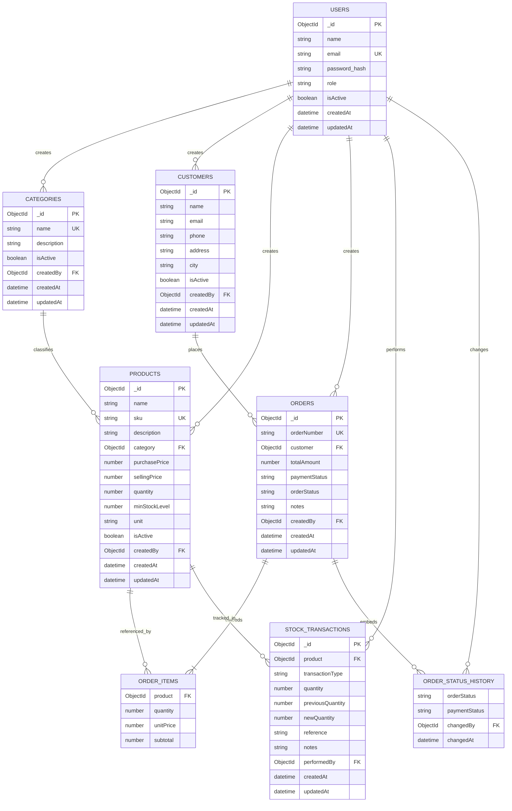

# NexaStock database structure

NexaStock stores data in MongoDB using Mongoose models. MongoDB is document-based, so the diagram below shows collections and their ObjectId references. It is an ER-style view of the data, not a relational SQL schema.

## ER-style diagram

`ORDER_ITEMS` and `ORDER_STATUS_HISTORY` are embedded subdocuments inside an order; they are not separate MongoDB collections. `password_hash` represents the `password` field stored as a bcrypt hash. The password field is excluded from normal user queries.

## Collections and important fields

### Users

Stores account identity and role. `email` is unique and normalized to lowercase. Roles are `admin`, `manager`, and `user`; new accounts default to `user`. Passwords are hashed with bcrypt before storage. `isActive` controls whether an account can sign in.

### Categories

Stores a unique category `name`, optional `description`, active status, creator reference, and timestamps. Deleting a category deactivates it instead of physically removing its document.

### Products

Stores the product name, unique uppercase `sku`, category reference, purchase and selling prices, stock quantity, minimum stock level, unit, active status, creator reference, and timestamps. New products begin with quantity zero; stock is changed through stock operations or order creation. Low stock means `quantity <= minStockLevel`.

### Customers

Stores customer name and phone (required), plus optional email, address, and city. Customer documents include active status, creator reference, and timestamps. Deletion is a soft deactivation.

### Orders

Stores a unique order number, customer reference, embedded line items, total amount, payment and order statuses, status history, notes, creator reference, and timestamps. Each embedded item records a product reference, quantity, unit-price snapshot, and subtotal. Status-history entries record both statuses, the user who changed them, and the change time.

Order creation and the related product quantity deductions and stock transaction records are performed in a MongoDB transaction. The order stores price snapshots so the invoice remains meaningful if a product price changes later.

### Stock transactions

Stores a stock movement for one product: transaction type (`purchase`, `sale`, `return`, or `adjustment`), movement quantity, quantity before and after, optional reference and notes, performing user, and timestamps. Order creation creates `sale` transactions automatically.

## References and deletion behavior

Mongoose ObjectId references connect documents. MongoDB does not enforce these references as SQL foreign keys; the application checks referenced products, customers, and categories when creating records. Products, categories, and customers use soft deletion (`isActive: false`) so historical order and stock records are retained.

## Database requirements

The backend uses multi-document transactions for order creation and stock adjustments. Use MongoDB Atlas or another MongoDB deployment configured as a replica set; a basic standalone MongoDB server does not support these transactions.

